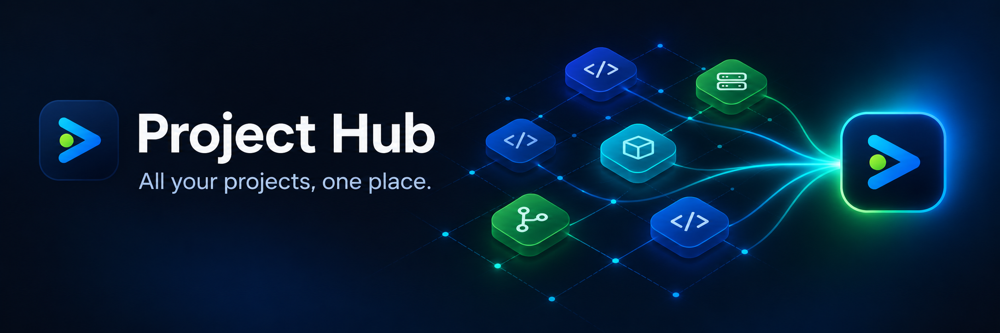

<h1></h1>

Project Hub is a local macOS app for finding code projects, opening them in your editor or AI coding tool, and running development servers.

## Why Project Hub

When projects live in different folders, getting back to work means finding the right repository, opening the right tools, and remembering how to start its server. Project Hub puts those everyday actions in one place.


## Download and install

Download the Universal macOS ZIP from the [latest release](https://github.com/Tranz007/projecthub/releases/latest). Project Hub requires macOS 14 or later and runs on Intel and Apple silicon Macs. Unzip the download, move **Project Hub.app** to Applications, and open it. The release is signed with Developer ID and notarized by Apple.

On first launch, choose a folder to scan, add an individual project, or scan the immediate subfolders of your Desktop.

## What you can do

### Find and browse projects

- Scan the immediate subfolders of chosen folders, or add a project with `.git`, `package.json`, or `pyproject.toml` directly.
- Browse a list or cards with a collapsible sidebar. The last known project list appears immediately while a background scan runs; use **Refresh projects** to scan again.
- See technologies, repository links, optional hosting links, and local server status. Hover for details, or select a repository or hosting icon to open its URL.

### Open your tools

- Open a project in Cursor, Visual Studio Code, Zed, or a custom editor.
- Launch Codex, Claude Code, Gemini CLI, or a custom command in a Terminal session scoped to the project. Install these tools separately.
- If a selected editor or built-in AI tool is unavailable, Project Hub points you to **Settings → Tools**. Custom commands run as entered.

### Run local servers

- Start or stop a development server from a project row or card. The status indicator shows when a server is starting, running, warning, or has exited unexpectedly.
- Select a running indicator to open the local site in your default browser. List rows also provide access to the site and server logs.
- Project Hub detects a standard Node `dev` script, or you can configure a command with `{port}`. It selects a free local port and stops managed servers when the app quits.

## Set up your workspace

Use **Add** in the main window or **Settings** (`⌘,`) to manage project sources. Settings also lets you choose an editor and AI tool. Each project's **Configure** control stores its server command, optional hosting provider and site URL, and favorite state. Hosting details are entered by you; Project Hub does not check deployment status.

Settings and the last scanned project list are stored on your Mac in `~/Library/Application Support/ProjectHub/settings.json` and `projects-cache.json`. Project Hub does not require an account or send project data to a server. Configured project and AI commands run locally with your user permissions, so review them before saving.

## Build from source

Building requires macOS 14 or later and Xcode command-line tools with Swift 6 support.

```sh
git clone https://github.com/Tranz007/projecthub.git
cd projecthub
./script/build_and_run.sh
```

The script builds a Universal app at `dist/Project Hub.app` and opens it. Use `./script/build_and_run.sh --build` to build without launching. The local build is ad hoc signed; use the notarized release for a public download.

To regenerate the Command Orbit app icon, run `swift script/generate_app_icon.swift` from the repository root. This updates `Resources/AppIcon.png` and `Resources/AppIcon.icns`.

## Contributing

Run `swift build -c release` and `swift test` before opening a pull request. Include steps to reproduce a bug or a short description of the behavior a change adds.

## License

Code and original app artwork are available under [MIT](LICENSE). Technology logos are credited in [THIRD_PARTY_NOTICES.md](THIRD_PARTY_NOTICES.md); brand marks remain the property of their owners.
