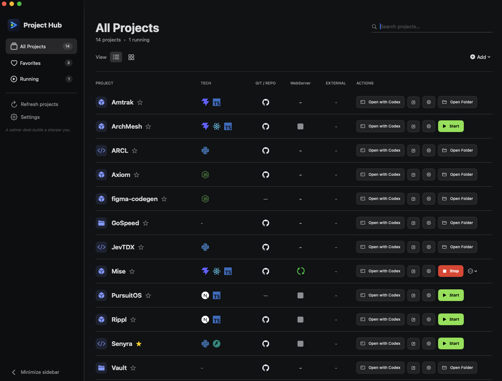

# ProjectHub

ProjectHub is a local macOS app for finding code projects, opening them in an editor or AI command-line tool, and starting development servers.



## Download and install

Download the Universal macOS ZIP from the [latest GitHub release](https://github.com/Tranz007/projecthub/releases/latest). It runs natively on Intel and Apple silicon Macs with macOS 14 or later. Unzip it, move **Project Hub.app** to Applications, and open it. The release download is signed with Developer ID and notarized by Apple.

Your project list is created on your Mac. On first launch, choose a folder, add a project, or scan the immediate subfolders of your Desktop. The download does not contain the maintainer's projects or settings.

## Features

- Choose folders to scan or add an individual project with `.git`, `package.json`, or `pyproject.toml`.
- See the last known project list immediately on launch while ProjectHub refreshes it in the background. Use **Refresh projects** to scan immediately.
- Browse in a list or cards, with automatic or selected card columns and a collapsible sidebar.
- See technology logos, local server status, and an optional external hosting provider. Hover over a logo for its name, a project name for its description, or a repository or hosting icon for details. Click a repository or hosting icon to open its URL.
- Open a project in Cursor, Visual Studio Code, Zed, or a custom editor.
- Launch Codex, Claude Code, Gemini CLI, or a custom command in a project-scoped Terminal session. Install those tools separately.
- Start or stop a development server from a list row or card. The server indicator shows stopped, starting, running, warning, or unexpected exit, with details on hover; select the running indicator to open the site in your default browser. List row server actions also provide the local site and logs. Managed servers stop when ProjectHub quits. A standard Node `dev` script is detected automatically; other projects can use a configured command with `{port}`. ProjectHub selects a free local port when starting a server.

## Build from source

Requires macOS 14 or later and Xcode command-line tools with Swift 6 support.

```sh
git clone https://github.com/Tranz007/projecthub.git
cd projecthub
./script/build_and_run.sh
```

The script builds a Universal app for Intel and Apple silicon at `dist/Project Hub.app` and opens it locally. `./script/build_and_run.sh --build` builds without launching. The app is ad hoc signed for local use; this local bundle is not a notarized public download. You can check its architectures with `lipo -archs "dist/Project Hub.app/Contents/MacOS/ProjectHub"`.

The Command Orbit app icon is generated from `script/generate_app_icon.swift`. Run `swift script/generate_app_icon.swift` from the repository root to regenerate `Resources/AppIcon.png` and the multi-size `Resources/AppIcon.icns` used by the app bundle.

On first launch, choose a scan folder, add one project, or continue with the default `~/Desktop` scan. ProjectHub scans only the immediate subfolders of each scan folder. Use **Add** in the main window or **Settings** / **⌘,** to manage sources. Settings also selects an editor and AI tool. Each project's **Configure** control stores its command, external hosting provider and site URL, and favorite state. External hosting details are set by the user; ProjectHub does not query deployment status.

Settings and the last scanned project list are stored locally at `~/Library/Application Support/ProjectHub/settings.json` and `projects-cache.json`. ProjectHub does not require an account or send project data to a server. Configured project and AI commands run locally with your user permissions; review commands before saving them.

## Contributing

Run `swift build -c release` and `swift test` before opening a pull request. Please include clear steps to reproduce a bug or a short description of the behavior a change adds.

## License

Code and original app artwork are available under [MIT](LICENSE). Technology logos are credited separately in [THIRD_PARTY_NOTICES.md](THIRD_PARTY_NOTICES.md); brand marks remain the property of their owners.
